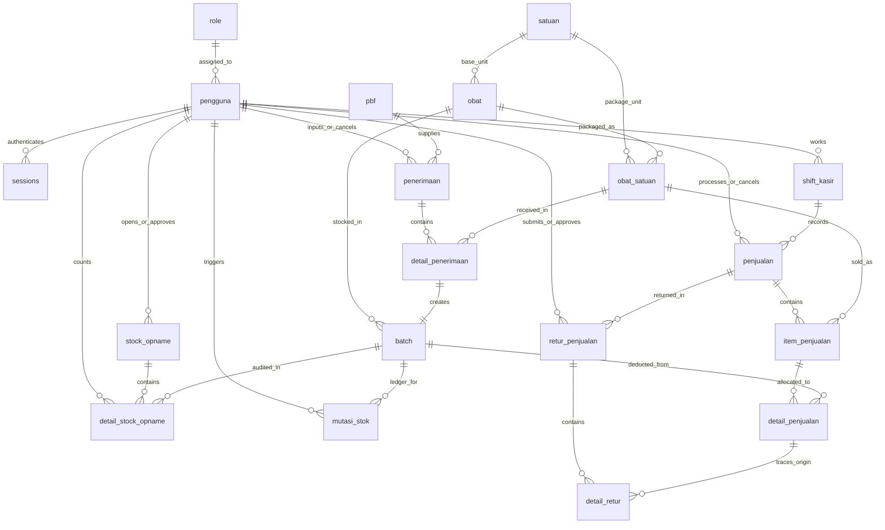

# Sistem Apotek Sumber Waras Database Specification

This document is the authoritative database specification for **Sistem Apotek Sumber Waras**, referenced as a strict rule by [PRD.MD](PRD.MD).

- **Engine:** PostgreSQL 17
- **Driver & Pooling:** `github.com/jackc/pgx/v5` (`pgxpool`) with explicit ACID transaction control
- **Scope:** 19 tables (the 17 core tables from the Week 12 update plus `sessions` and `shift_kasir` for session revocation and cashier shift binding)
- **Global Integrity Rules:**
  - All foreign keys use `ON DELETE RESTRICT` unless noted otherwise to protect audit history against hard deletes.
  - Every stock quantity in `batch`, `mutasi_stok`, `detail_penerimaan`, `detail_penjualan`, `detail_retur`, and `detail_stock_opname` is stored in the medicine's smallest base unit (`satuan_dasar_id`).
  - Purchase unit costs (`harga_beli_dasar`, `harga_beli_saat_jual`) use `NUMERIC(14,4)`.
  - Concurrent POS checkouts lock candidate `batch` rows in FEFO order using `SELECT ... FOR UPDATE` inside a short transaction so `stok_tersisa` never drops below zero.

## Database structure

### 1. Authentication, roles, and cashier shifts

#### `role`

| Column | Type | Constraints | Description |
| :--- | :--- | :--- | :--- |
| `id_role` | `SERIAL` | `PRIMARY KEY` | Role identifier |
| `nama_role` | `VARCHAR(30)` | `UNIQUE NOT NULL` | `kasir`, `staf`, or `pemilik` |
| `deskripsi` | `TEXT` | `NULL` | Role description |
| `created_at` | `TIMESTAMPTZ` | `NOT NULL DEFAULT NOW()` | Creation timestamp |
| `updated_at` | `TIMESTAMPTZ` | `NOT NULL DEFAULT NOW()` | Last update timestamp |

#### `pengguna`

| Column | Type | Constraints | Description |
| :--- | :--- | :--- | :--- |
| `id_pengguna` | `SERIAL` | `PRIMARY KEY` | User identifier |
| `id_role` | `INT` | `NOT NULL REFERENCES role(id_role)` | Assigned role |
| `nama_pengguna` | `VARCHAR(100)` | `NOT NULL` | Full display name |
| `username` | `VARCHAR(50)` | `UNIQUE NOT NULL` | Login username |
| `email` | `VARCHAR(150)` | `UNIQUE NULL` | Optional employee email |
| `password_hash` | `VARCHAR(255)` | `NOT NULL` | Bcrypt password hash |
| `status_aktif` | `BOOLEAN` | `NOT NULL DEFAULT TRUE` | Account status (`false` blocks login and active requests) |
| `created_at` | `TIMESTAMPTZ` | `NOT NULL DEFAULT NOW()` | Creation timestamp |
| `updated_at` | `TIMESTAMPTZ` | `NOT NULL DEFAULT NOW()` | Last update timestamp |
| `last_login` | `TIMESTAMPTZ` | `NULL` | Most recent login timestamp |

#### `sessions`

| Column | Type | Constraints | Description |
| :--- | :--- | :--- | :--- |
| `id_session` | `SERIAL` | `PRIMARY KEY` | Session identifier |
| `id_pengguna` | `INT` | `NOT NULL REFERENCES pengguna(id_pengguna)` | Logged-in user |
| `token_hash` | `VARCHAR(64)` | `UNIQUE NOT NULL` | SHA-256 hash of `HttpOnly` cookie token |
| `expires_at` | `TIMESTAMPTZ` | `NOT NULL` | Session expiration time |
| `created_at` | `TIMESTAMPTZ` | `NOT NULL DEFAULT NOW()` | Session start time |

#### `shift_kasir`

| Column | Type | Constraints | Description |
| :--- | :--- | :--- | :--- |
| `id_shift` | `SERIAL` | `PRIMARY KEY` | Shift identifier |
| `id_pengguna` | `INT` | `NOT NULL REFERENCES pengguna(id_pengguna)` | Cashier on duty |
| `saldo_awal` | `INT` | `NOT NULL DEFAULT 0 CHECK (saldo_awal >= 0)` | Opening cash drawer balance |
| `kas_fisik_akhir` | `INT` | `NULL CHECK (kas_fisik_akhir >= 0)` | Counted cash when closing shift |
| `status_shift` | `VARCHAR(20)` | `NOT NULL DEFAULT 'AKTIF' CHECK (status_shift IN ('AKTIF','TERKUNCI','TUTUP'))` | Shift state |
| `waktu_buka` | `TIMESTAMPTZ` | `NOT NULL DEFAULT NOW()` | Shift open timestamp |
| `waktu_tutup` | `TIMESTAMPTZ` | `NULL` | Shift close timestamp |

### 2. Medicine catalog, units, and distributors

#### `satuan`

| Column | Type | Constraints | Description |
| :--- | :--- | :--- | :--- |
| `id_satuan` | `SERIAL` | `PRIMARY KEY` | Unit identifier |
| `nama_satuan` | `VARCHAR(50)` | `UNIQUE NOT NULL` | Unit name (`tablet`, `strip`, `botol`, `box`, `tube`) |

#### `obat`

| Column | Type | Constraints | Description |
| :--- | :--- | :--- | :--- |
| `id_obat` | `SERIAL` | `PRIMARY KEY` | Medicine identifier |
| `kode_obat` | `VARCHAR(30)` | `UNIQUE NOT NULL` | Unique medicine code |
| `nama_obat` | `VARCHAR(150)` | `NOT NULL` | Medicine name |
| `kandungan` | `TEXT` | `NULL` | Active composition |
| `satuan_dasar_id` | `INT` | `NOT NULL REFERENCES satuan(id_satuan)` | Base unit used for all stock math |
| `lokasi_rak` | `VARCHAR(50)` | `NOT NULL DEFAULT 'RAK-UMUM'` | Physical shelf location |
| `status_aktif` | `BOOLEAN` | `NOT NULL DEFAULT TRUE` | Soft delete flag |

#### `obat_satuan`

| Column | Type | Constraints | Description |
| :--- | :--- | :--- | :--- |
| `id_obat_satuan` | `SERIAL` | `PRIMARY KEY` | Packaging configuration identifier |
| `id_obat` | `INT` | `NOT NULL REFERENCES obat(id_obat)` | Medicine reference |
| `id_satuan` | `INT` | `NOT NULL REFERENCES satuan(id_satuan)` | Packaging unit reference |
| `faktor_konversi` | `INT` | `NOT NULL CHECK (faktor_konversi > 0)` | Base units per package |
| `harga_jual` | `INT` | `NOT NULL DEFAULT 0 CHECK (harga_jual >= 0)` | Selling price in rupiah (`pemilik` only) |
| `boleh_dijual` | `BOOLEAN` | `NOT NULL DEFAULT TRUE` | Whether POS can sell this packaging |
| `aktif` | `BOOLEAN` | `NOT NULL DEFAULT TRUE` | Active flag |

Unique constraint: `UNIQUE (id_obat, id_satuan)`.

#### `pbf`

| Column | Type | Constraints | Description |
| :--- | :--- | :--- | :--- |
| `id_pbf` | `SERIAL` | `PRIMARY KEY` | Distributor identifier |
| `nama_pbf` | `VARCHAR(150)` | `UNIQUE NOT NULL` | Pharmaceutical distributor name |
| `aktif` | `BOOLEAN` | `NOT NULL DEFAULT TRUE` | Active flag |

### 3. PBF receiving, batches, and stock ledger

#### `penerimaan`

| Column | Type | Constraints | Description |
| :--- | :--- | :--- | :--- |
| `id_penerimaan` | `SERIAL` | `PRIMARY KEY` | Receiving header identifier |
| `id_pbf` | `INT` | `NOT NULL REFERENCES pbf(id_pbf)` | Source distributor |
| `no_faktur` | `VARCHAR(100)` | `NOT NULL` | Invoice number from PBF |
| `tanggal_faktur` | `DATE` | `NOT NULL` | Invoice issue date |
| `tanggal_terima` | `DATE` | `NOT NULL DEFAULT CURRENT_DATE` | Date goods arrived |
| `id_pengguna` | `INT` | `NOT NULL REFERENCES pengguna(id_pengguna)` | Staff or owner who recorded intake |
| `total_faktur` | `INT` | `NOT NULL CHECK (total_faktur >= 0)` | Total invoice value |
| `status` | `VARCHAR(20)` | `NOT NULL DEFAULT 'DITERIMA' CHECK (status IN ('DITERIMA','DIBATALKAN'))` | Document state |
| `alasan_batal` | `TEXT` | `NULL` | Cancellation reason |
| `waktu_batal` | `TIMESTAMPTZ` | `NULL` | Cancellation timestamp |
| `id_pengguna_batal` | `INT` | `NULL REFERENCES pengguna(id_pengguna)` | Owner who canceled |

Unique constraint: `UNIQUE (id_pbf, no_faktur)`.

#### `batch`

| Column | Type | Constraints | Description |
| :--- | :--- | :--- | :--- |
| `id_batch` | `SERIAL` | `PRIMARY KEY` | Batch identifier |
| `id_obat` | `INT` | `NOT NULL REFERENCES obat(id_obat)` | Parent medicine |
| `nomor_batch` | `VARCHAR(100)` | `NOT NULL` | Manufacturer batch number |
| `tanggal_kedaluwarsa` | `DATE` | `NOT NULL` | Expiration date |
| `harga_beli_dasar` | `NUMERIC(14,4)` | `NOT NULL CHECK (harga_beli_dasar >= 0)` | Purchase cost per base unit |
| `stok_tersisa` | `INT` | `NOT NULL DEFAULT 0 CHECK (stok_tersisa >= 0)` | Remaining sellable base units |
| `status_batch` | `VARCHAR(20)` | `NOT NULL DEFAULT 'AKTIF' CHECK (status_batch IN ('AKTIF','HAMPIR_ED','KEDALUWARSA','HABIS'))` | Batch status |
| `waktu_dibuat` | `TIMESTAMPTZ` | `NOT NULL DEFAULT NOW()` | Batch creation timestamp |

Index: `(id_obat, status_batch, tanggal_kedaluwarsa)` for FEFO allocation and expiry queries.

#### `detail_penerimaan`

| Column | Type | Constraints | Description |
| :--- | :--- | :--- | :--- |
| `id_detail_penerimaan` | `SERIAL` | `PRIMARY KEY` | Receiving line identifier |
| `id_penerimaan` | `INT` | `NOT NULL REFERENCES penerimaan(id_penerimaan)` | Parent invoice |
| `id_batch` | `INT` | `UNIQUE NOT NULL REFERENCES batch(id_batch)` | Batch created by this line (`1:1`) |
| `id_obat_satuan` | `INT` | `NOT NULL REFERENCES obat_satuan(id_obat_satuan)` | Invoice packaging unit |
| `jumlah_faktur` | `INT` | `NOT NULL CHECK (jumlah_faktur > 0)` | Quantity in invoice unit |
| `harga_faktur` | `INT` | `NOT NULL CHECK (harga_faktur >= 0)` | Purchase price per invoice unit |
| `faktor_konversi` | `INT` | `NOT NULL CHECK (faktor_konversi > 0)` | Conversion snapshot at intake |
| `jumlah_dasar` | `INT` | `NOT NULL CHECK (jumlah_dasar > 0)` | `jumlah_faktur * faktor_konversi` |
| `subtotal` | `INT` | `NOT NULL CHECK (subtotal >= 0)` | `jumlah_faktur * harga_faktur` |

#### `mutasi_stok`

| Column | Type | Constraints | Description |
| :--- | :--- | :--- | :--- |
| `id_mutasi` | `SERIAL` | `PRIMARY KEY` | Ledger entry identifier |
| `id_batch` | `INT` | `NOT NULL REFERENCES batch(id_batch)` | Affected batch |
| `jenis_mutasi` | `VARCHAR(30)` | `NOT NULL` | `PENERIMAAN`, `PENJUALAN`, `PEMBATALAN_PENJUALAN`, `PEMBATALAN_PENERIMAAN`, `RETUR_MASUK`, `PENYESUAIAN_OPNAME` |
| `jumlah_dasar` | `INT` | `NOT NULL` | Signed delta in base units (`+` in, `-` out) |
| `jenis_referensi` | `VARCHAR(50)` | `NOT NULL` | Source table (`penerimaan`, `penjualan`, `retur_penjualan`, `stock_opname`) |
| `id_referensi` | `INT` | `NOT NULL` | Source primary key ID |
| `id_pengguna` | `INT` | `NOT NULL REFERENCES pengguna(id_pengguna)` | User who triggered the change |
| `waktu_mutasi` | `TIMESTAMPTZ` | `NOT NULL DEFAULT NOW()` | Mutation timestamp |

Indexes: `(id_batch, waktu_mutasi)` and `(jenis_referensi, id_referensi)`.

Every stock adjustment appends its ledger entry in the transaction that changes `batch.stok_tersisa`. Opname checks for intervening ledger entries under the batch lock before accepting a count.

### 4. POS sales

#### `penjualan`

| Column | Type | Constraints | Description |
| :--- | :--- | :--- | :--- |
| `id_penjualan` | `SERIAL` | `PRIMARY KEY` | Sale header identifier |
| `nomor_transaksi` | `VARCHAR(50)` | `UNIQUE NOT NULL` | Receipt number |
| `tanggal_penjualan` | `TIMESTAMPTZ` | `NOT NULL DEFAULT NOW()` | Transaction timestamp |
| `id_pengguna` | `INT` | `NOT NULL REFERENCES pengguna(id_pengguna)` | Cashier who processed sale |
| `id_shift` | `INT` | `NULL REFERENCES shift_kasir(id_shift)` | Active cashier shift |
| `total_penjualan` | `INT` | `NOT NULL CHECK (total_penjualan >= 0)` | Total sale revenue |
| `total_hpp` | `INT` | `NOT NULL CHECK (total_hpp >= 0)` | Total COGS from allocated batches |
| `metode_pembayaran` | `VARCHAR(20)` | `NOT NULL DEFAULT 'TUNAI' CHECK (metode_pembayaran IN ('TUNAI','QRIS','DEBIT'))` | Payment method |
| `jumlah_bayar` | `INT` | `NOT NULL DEFAULT 0 CHECK (jumlah_bayar >= 0)` | Amount tendered by buyer |
| `kembalian` | `INT` | `NOT NULL DEFAULT 0 CHECK (kembalian >= 0)` | Change returned to buyer |
| `status` | `VARCHAR(20)` | `NOT NULL DEFAULT 'SELESAI' CHECK (status IN ('SELESAI','DIBATALKAN'))` | Sale state |
| `alasan_batal` | `TEXT` | `NULL` | Void or cancellation reason |
| `waktu_batal` | `TIMESTAMPTZ` | `NULL` | Void or cancellation timestamp |
| `id_pengguna_batal` | `INT` | `NULL REFERENCES pengguna(id_pengguna)` | User who canceled |

#### `item_penjualan`

| Column | Type | Constraints | Description |
| :--- | :--- | :--- | :--- |
| `id_item` | `SERIAL` | `PRIMARY KEY` | Cart line identifier |
| `id_penjualan` | `INT` | `NOT NULL REFERENCES penjualan(id_penjualan)` | Parent sale |
| `id_obat_satuan` | `INT` | `NOT NULL REFERENCES obat_satuan(id_obat_satuan)` | Sold packaging unit |
| `jumlah` | `INT` | `NOT NULL CHECK (jumlah > 0)` | Quantity in sold packaging |
| `faktor_konversi` | `INT` | `NOT NULL CHECK (faktor_konversi > 0)` | Conversion snapshot at sale |
| `jumlah_dasar` | `INT` | `NOT NULL CHECK (jumlah_dasar > 0)` | `jumlah * faktor_konversi` |
| `harga_jual_saat_jual` | `INT` | `NOT NULL CHECK (harga_jual_saat_jual >= 0)` | Unit selling price snapshot |
| `subtotal` | `INT` | `NOT NULL CHECK (subtotal >= 0)` | `jumlah * harga_jual_saat_jual` |

#### `detail_penjualan`

| Column | Type | Constraints | Description |
| :--- | :--- | :--- | :--- |
| `id_detail` | `SERIAL` | `PRIMARY KEY` | Batch allocation line identifier |
| `id_item` | `INT` | `NOT NULL REFERENCES item_penjualan(id_item)` | Parent cart line |
| `id_batch` | `INT` | `NOT NULL REFERENCES batch(id_batch)` | Batch deducted by FEFO |
| `urutan_fefo` | `INT` | `NOT NULL CHECK (urutan_fefo > 0)` | Allocation sequence (`1, 2, ...`) |
| `jumlah_dasar` | `INT` | `NOT NULL CHECK (jumlah_dasar > 0)` | Base units deducted from batch |
| `harga_beli_saat_jual` | `NUMERIC(14,4)` | `NOT NULL CHECK (harga_beli_saat_jual >= 0)` | Base unit cost snapshot |
| `hpp` | `INT` | `NOT NULL CHECK (hpp >= 0)` | `ROUND(jumlah_dasar * harga_beli_saat_jual)` |

### 5. Sales returns

#### `retur_penjualan`

| Column | Type | Constraints | Description |
| :--- | :--- | :--- | :--- |
| `id_retur` | `SERIAL` | `PRIMARY KEY` | Return header identifier |
| `nomor_retur` | `VARCHAR(50)` | `UNIQUE NOT NULL` | Return document number |
| `id_penjualan` | `INT` | `NOT NULL REFERENCES penjualan(id_penjualan)` | Original receipt (`<= 3` calendar days) |
| `id_pengguna` | `INT` | `NOT NULL REFERENCES pengguna(id_pengguna)` | Cashier or owner who created return |
| `id_pengguna_penyetuju` | `INT` | `NULL REFERENCES pengguna(id_pengguna)` | Owner who approved or rejected |
| `tanggal_retur` | `TIMESTAMPTZ` | `NOT NULL DEFAULT NOW()` | Return submission timestamp |
| `total_pengembalian` | `INT` | `NOT NULL CHECK (total_pengembalian >= 0)` | Total refund amount |
| `status` | `VARCHAR(30)` | `NOT NULL DEFAULT 'MENUNGGU_PERSETUJUAN' CHECK (status IN ('MENUNGGU_PERSETUJUAN','DISETUJUI','DITOLAK'))` | Approval state |
| `catatan_penyetuju` | `TEXT` | `NULL` | Owner approval or rejection note |
| `waktu_selesai` | `TIMESTAMPTZ` | `NULL` | Approval or rejection timestamp |

#### `detail_retur`

| Column | Type | Constraints | Description |
| :--- | :--- | :--- | :--- |
| `id_detail_retur` | `SERIAL` | `PRIMARY KEY` | Return line identifier |
| `id_retur` | `INT` | `NOT NULL REFERENCES retur_penjualan(id_retur)` | Parent return |
| `id_detail` | `INT` | `NOT NULL REFERENCES detail_penjualan(id_detail)` | Original batch allocation line |
| `jumlah_dasar` | `INT` | `NOT NULL CHECK (jumlah_dasar > 0)` | Returned quantity in base units |
| `alasan_retur` | `TEXT` | `NOT NULL` | Reason for return |
| `kondisi_obat` | `VARCHAR(50)` | `NOT NULL` | Physical condition check |
| `status_stok` | `VARCHAR(30)` | `NOT NULL CHECK (status_stok IN ('MASUK_STOK','TIDAK_MASUK_STOK'))` | Determines if stock returns to `batch.stok_tersisa` |
| `subtotal_pengembalian` | `INT` | `NOT NULL CHECK (subtotal_pengembalian >= 0)` | Refund value for this line |

For each `id_detail`, the service caps the sum of pending and approved return quantities at `detail_penjualan.jumlah_dasar`. Changes to a return and cancellation of its sale serialize on the parent `penjualan` row.

### 6. Stock opname

#### `stock_opname`

| Column | Type | Constraints | Description |
| :--- | :--- | :--- | :--- |
| `id_stock_opname` | `SERIAL` | `PRIMARY KEY` | Opname session identifier |
| `nomor_sesi` | `VARCHAR(50)` | `UNIQUE NOT NULL` | Session code |
| `tanggal_opname` | `DATE` | `NOT NULL DEFAULT CURRENT_DATE` | Opname date |
| `id_pengguna` | `INT` | `NOT NULL REFERENCES pengguna(id_pengguna)` | Staff or owner who opened session |
| `id_pengguna_penyetuju` | `INT` | `NULL REFERENCES pengguna(id_pengguna)` | Owner who reviewed session |
| `status` | `VARCHAR(30)` | `NOT NULL DEFAULT 'DRAFT' CHECK (status IN ('DRAFT','MENUNGGU_PERSETUJUAN','SELESAI','DITOLAK'))` | Session state |
| `catatan_penyetuju` | `TEXT` | `NULL` | Owner review or rejection note |
| `waktu_persetujuan` | `TIMESTAMPTZ` | `NULL` | Approval timestamp |

#### `detail_stock_opname`

| Column | Type | Constraints | Description |
| :--- | :--- | :--- | :--- |
| `id_detail_opname` | `SERIAL` | `PRIMARY KEY` | Opname count line identifier |
| `id_stock_opname` | `INT` | `NOT NULL REFERENCES stock_opname(id_stock_opname)` | Parent opname session |
| `id_batch` | `INT` | `NOT NULL REFERENCES batch(id_batch)` | Counted batch |
| `stok_sistem` | `INT` | `NOT NULL` | Locked system stock when a batch count is saved; visible only in the owner's submitted review |
| `stok_fisik` | `INT` | `NOT NULL CHECK (stok_fisik >= 0)` | Physical shelf count |
| `selisih_stok` | `INT` | `NOT NULL` | `stok_fisik - stok_sistem`; apply the latest accepted variance to current stock on approval |
| `alasan_selisih` | `TEXT` | `NULL` | Required when `selisih_stok != 0` |
| `urutan_penghitungan` | `INT` | `NOT NULL DEFAULT 1 CHECK (urutan_penghitungan > 0)` | Count revision sequence |
| `id_pengguna` | `INT` | `NOT NULL REFERENCES pengguna(id_pengguna)` | Staff member who counted |
| `waktu_hitung` | `TIMESTAMPTZ` | `NOT NULL DEFAULT NOW()` | Count timestamp |
| `status_hasil` | `VARCHAR(20)` | `NOT NULL DEFAULT 'PENDING' CHECK (status_hasil IN ('PENDING','SELESAI'))` | Line adjustment status |

Unique constraint: `UNIQUE (id_stock_opname, id_batch, urutan_penghitungan)`.

## Database relationships

### Cardinality summary

1. `role` to `pengguna` is `1:N`. Each user has one role (`id_role`).
2. `pengguna` to `sessions` and `shift_kasir` is `1:N`. Every HTTP request joins `sessions` with `pengguna` and `role` to enforce `status_aktif = true`.
3. `satuan` to `obat` is `1:N` (one base unit per medicine), and `obat` to `obat_satuan` is `1:N` (multiple sellable or receivable packages per medicine).
4. `pbf` to `penerimaan` is `1:N`, `penerimaan` to `detail_penerimaan` is `1:N`, and `detail_penerimaan` to `batch` is `1:1` (`id_batch` is `UNIQUE` on `detail_penerimaan`).
5. `shift_kasir` to `penjualan` is `1:N` (optional `0..1` if a sale happens during an owner shift, or `1:N` bound to the active cashier shift).
6. `penjualan` to `item_penjualan` is `1:N`, and `item_penjualan` to `detail_penjualan` is `1:N` because one sold packaging item can draw from multiple batches under FEFO.
7. `penjualan` to `retur_penjualan` is `1:N`, `retur_penjualan` to `detail_retur` is `1:N`, and `detail_penjualan` to `detail_retur` is `1:N`. Each return line traces back to the exact `batch` through `detail_penjualan.id_batch`.
8. `stock_opname` to `detail_stock_opname` is `1:N`, and `batch` to `detail_stock_opname` is `1:N` across opname sessions and recount revisions.
9. `batch` to `mutasi_stok` is `1:N`. `mutasi_stok` links polymorphically to `penerimaan`, `penjualan`, `retur_penjualan`, and `stock_opname` via `(jenis_referensi, id_referensi)`.
